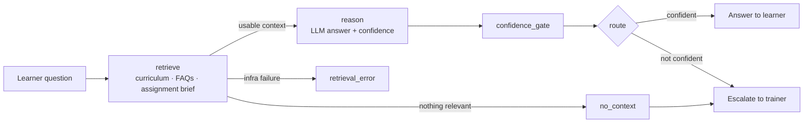

# KodeBuddy AI — Backend

KodeBuddy AI is a learning platform for coding bootcamps with an AI teaching assistant built in. Learners ask questions about their course and get answers grounded in **their own curriculum**. When the AI isn't confident, the question goes to a human trainer instead of getting a guessed answer.

This repo is the **FastAPI backend and AI agent**. The Next.js frontend is at **[david-ohimai/fe-kodebuddy-ai](https://github.com/david-ohimai/fe-kodebuddy-ai)**.

> Built as a team capstone project at KodeCamp. This is a portfolio copy of the original team repository, with full commit history kept.

---

## Highlights

- **RAG teaching assistant (LangGraph):** retrieves curriculum, FAQ and assignment context with pgvector similarity search, then reasons over it with an LLM.
- **Confidence-gated escalation:** low-confidence answers aren't shown to the learner. They're escalated to the learner's trainer, with the AI's draft attached for review.
- **Access rules enforced in SQL:** every retrieval query joins on the learner's own enrollments. A learner can never retrieve content from a course they aren't enrolled in, even if the calling code has a bug.
- **Multi-provider LLM fallback:** Gemini first, OpenRouter as a fallback, behind one `LLMClient` interface. One provider's outage or rate limit doesn't break the chat.
- **Document ingestion:** trainers upload PDF, DOCX, TXT or Markdown resources. Text is extracted, split into chunks, embedded (Gemini `gemini-embedding-001`) and indexed automatically.
- **Full LMS domain:** four roles (admin, trainer, mentor, learner); cohorts, courses, modules, lessons, resources, assignments, submissions and grading, progress tracking, notifications and activity feeds.
- **Observability and evals:** LangSmith tracing, per-query logs, conversation history, and an offline eval set for the agent.

## Agent architecture



If retrieval finds nothing, the graph skips the LLM call entirely rather than letting the model answer from nothing.

## Tech stack

| Area | Tools |
|---|---|
| API | Python, FastAPI, Pydantic, SQLModel / SQLAlchemy |
| Database | PostgreSQL, **pgvector**, Alembic migrations |
| AI / agent | LangGraph, LangChain Core, Google Gemini, OpenRouter, LangSmith |
| Auth | JWT access and refresh tokens, Argon2 password hashing, role-based access control |
| Files | pypdf, python-docx, multipart uploads |
| Email | fastapi-mail (invitations, password reset) |
| Testing | pytest (70+ tests across retrieval, graph, ingestion, escalations, evals) |
| Hosting | Render |

## My contributions (David Ohimai)

I was the **Retrieval & Tools** engineer on the AI agent, and also worked on the assignments feature.

- **Designed and built the agent's retrieval layer** ([`app/agent/repository.py`](app/agent/repository.py)): pgvector cosine-similarity search over curriculum, FAQs and resources. Learner scoping is enforced inside the SQL itself, so access rules can't be bypassed by a caller.
- **Implemented the agent tools** ([`app/agent/tools/`](app/agent/tools/)): `search_curriculum`, `search_faqs`, `get_assignment_brief` and `escalate_to_trainer`, plus a factory that binds every tool to one learner when it's created, so a tool can never be handed the wrong `learner_id`.
- **Built the embedding seam** ([`app/agent/embedding_seam.py`](app/agent/embedding_seam.py)), which decouples retrieval from the embedding provider so tests run without network calls.
- **Wrote the retrieval test suite** ([`tests/test_agent_retrieval.py`](tests/test_agent_retrieval.py)).
- **Extended assignments and submissions:** added assignment start dates and creator names (with an Alembic migration), and fixed a join bug in submissions.

## API overview

Interactive docs are served at `/docs` (Swagger) and `/redoc` once the server is running.

| Area | Purpose |
|---|---|
| `/agent/chat`, `/agent/escalate`, `/agent/history` | AI teaching assistant |
| Auth, profile | Sign-up, invitations, login, token refresh, password reset |
| Cohorts, courses, modules, lessons, resources | Course content and structure |
| Assignments, submissions, progress | Learning workflow and grading |
| Mentors, escalations, notifications, activity, dashboard | Support and reporting |

## Running locally

**Prerequisites:** Python 3.11+, and PostgreSQL with the [`pgvector`](https://github.com/pgvector/pgvector) extension.

```bash
# 1. Install dependencies
python -m venv .venv
source .venv/bin/activate        # Windows: .venv\Scripts\activate
pip install -r requirements.txt

# 2. Configure the environment
cp .env.example .env             # then fill in DATABASE_URL, AUTH_SECRET_KEY, GEMINI_API_KEY, ...

# 3. Create the database schema
alembic upgrade head

# 4. Create the first admin user (uses INITIAL_ADMIN_PASSWORD)
python seed_admin.py

# 5. Run the API (the uploads folder must exist for static file serving)
mkdir -p uploads
uvicorn app.main:app --reload
```

The API runs at `http://localhost:8000`. To index existing course content for the agent, run `python scripts/ingest_curriculum.py`.

Run the tests with:

```bash
pip install -r requirements-dev.txt
pytest
```

## Project structure

```
app/
├── agent/            # AI assistant: LangGraph graph, tools, retrieval, LLM clients, ingestion, evals
│   ├── graph/        #   state, nodes and graph wiring
│   ├── tools/        #   search_curriculum, search_faqs, get_assignment_brief, escalate_to_trainer
│   └── prompts/
├── core/             # config, database, auth, security, email
└── features/         # one folder per domain: model / schema / repository / service / router
alembic/              # database migrations
scripts/              # curriculum ingestion
tests/
```

## Team

KodeBuddy AI was built by a cross-functional team on the KodeCamp capstone programme. See the [contributors graph](../../graphs/contributors) for everyone who worked on this repo.
